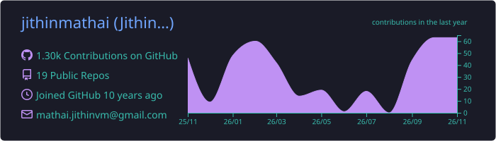
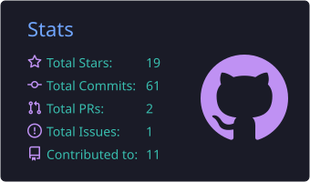
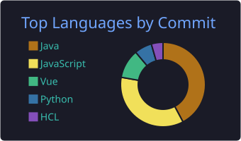

<!-- Header banner -->


<div align="center">

[](https://git.io/typing-svg)

[](https://www.linkedin.com/in/jithin-mathai-6719a24b/)
[](https://medium.com/@mathai.jithinvm)
[](mailto:mathai.jithinvm@gmail.com)


</div>

<!-- BIBLE-VERSE:START -->
<div align="center">

> 📖 *“For God so loved the world, as to give his only begotten Son; that whosoever believeth in him, may not perish, but may have life everlasting.”*  
> — **John 3:16** &nbsp;·&nbsp; <sub>*Douay-Rheims-Challoner (Catholic Bible)*</sub>

</div>
<!-- BIBLE-VERSE:END -->

## 🚀 About Me

I design and ship **cloud-native systems and AI agent orchestration platforms**. By day I build Spring Boot microservices that go native with GraalVM; by night I'm wiring LLMs into multi-agent workflows with LangGraph, AutoGen, and CrewAI — and lately building hands-on labs on **Microsoft Foundry** to see what its speech, language and safety services really do. I care about systems that are **fast, observable, and small enough to fit in a container someone actually wants to run**.

<table>
  <tr>
    <td width="50%" valign="top">
      <h4>🤖 Agent Orchestration</h4>
      Supervisor / worker hierarchies, tool calling, memory, RAG, evals &amp; human-in-the-loop.
    </td>
    <td width="50%" valign="top">
      <h4>☕ Backend + GraalVM</h4>
      Spring Boot 3 microservices compiled to native images with sub-100&nbsp;ms cold starts.
    </td>
  </tr>
  <tr>
    <td width="50%" valign="top">
      <h4>☁️ Cloud Native</h4>
      Azure / AWS / GCP, Kubernetes and event-driven architectures built to be observed.
    </td>
    <td width="50%" valign="top">
      <h4>🔌 Open Protocols</h4>
      Bullish on <b>MCP</b>, <b>A2A</b>, function calling and OpenAPI-as-contract.
    </td>
  </tr>
  <tr>
    <td width="50%" valign="top">
      <h4>🏗️ Microsoft Foundry</h4>
      Speech, Language, Translator, Content Understanding and gpt-4.1 wired into end-to-end pipelines.
    </td>
    <td width="50%" valign="top">
      <h4>🛡️ AI Security</h4>
      Prompt-injection testing, Prompt Shields, guardrails, PII redaction &amp; human-approval gates.
    </td>
  </tr>
</table>

```yaml
# ~/.config/jithin/now.yaml
role:         Cloud Native Architect · Backend Dev · AI Agent Orchestrator
since:        2015
education:    B.Tech CSE — Mar Athanasius College of Engineering, Kothamangalam
working_on:
  - Microsoft Foundry labs — scam-call detection & prompt-injection defences
  - Multi-agent platform on LangGraph + Spring AI, with Ragas evals
  - GraalVM native images for low-latency LLM gateways
  - MCP servers exposing filesystem, GitHub, Postgres & internal APIs to agents
  - Hexagonal architecture patterns in Spring Boot
learning:     [AI-103 (Azure AI Apps & Agents), Agent evals (DeepEval, Ragas, Braintrust), A2A, stateful long-running agents, service mesh]
ask_me_about: [Microsoft Foundry, Prompt Shields, LangGraph, Spring AI, GraalVM, Azure, MCP, Kubernetes]
philosophy:   "Make it work, make it right, make it fast — then make it native."
```

## 🛠️ Tech Stack

<div align="center">

<b>Languages &amp; Frameworks</b><br/><br/>


<br/><br/><b>Cloud, DevOps &amp; Data</b><br/><br/>


<br/><br/><b>🤖 AI Agent Orchestration</b> <sub><i>(where I live now)</i></sub><br/><br/>


<b>🏗️ Microsoft Foundry &amp; Azure AI</b><br/><br/>


<b>LLMs &amp; ML</b><br/><br/>


</div>

## 📊 GitHub Activity

<div align="center">







<picture>
  <source media="(prefers-color-scheme: dark)" srcset="https://raw.githubusercontent.com/jithinmathai/jithinmathai/output/github-snake-dark.svg" />
  <source media="(prefers-color-scheme: light)" srcset="https://raw.githubusercontent.com/jithinmathai/jithinmathai/output/github-snake.svg" />
  
</picture>

</div>

## 🧪 Featured Labs

<table>
  <tr>
    <td width="50%" valign="top">
      <h4>📞 <a href="https://github.com/jithinmathai/foundry-scam-call-analyzer">foundry-scam-call-analyzer</a></h4>
      Listens to a phone call, decides whether it's a scam, redacts personal data and warns the receiver out loud in English or Hindi.<br/><br/>
      <b>Pipeline:</b> fast transcription + diarization → language detection + Translator → PII redaction → gpt-4.1-mini (strict JSON) → neural TTS warning<br/><br/>
      <b>Result:</b> 7/7 synthetic scams flagged, 0/3 false alarms.<br/><br/>
      <a href="https://medium.com/@mathai.jithinvm/please-read-me-the-otp-i-built-a-scam-call-detector-on-microsoft-foundry-with-speech-language-48dbbcbc7cec">📰 Read the write-up</a>
    </td>
    <td width="50%" valign="top">
      <h4>🛡️ <a href="https://github.com/jithinmathai/foundry-prompt-injection-lab">foundry-prompt-injection-lab</a></h4>
      Attacks a document-processing agent with 14 poisoned PDFs to see which Foundry defence catches indirect prompt injection.<br/><br/>
      <b>Layers:</b> extraction (pypdf vs Content Understanding) → Prompt Shields → prompt hardening → guardrails → human approval on tools<br/><br/>
      <b>Result:</b> human approval was the control that stopped the agent emailing an attacker.<br/><br/>
      <a href="https://medium.com/@mathai.jithinvm/hidden-in-the-pdf-i-tested-microsoft-foundrys-prompt-injection-defences-with-14-poisoned-ba95b18c2eb8">📰 Read the write-up</a>
    </td>
  </tr>
</table>

## 🏅 Certifications

<div align="center">

| Certification | Issuer | Status | Credential |
|:--|:--:|:--|:--:|
| **Claude Certified Architect** · Foundations |  | ✅ Certified | [](https://www.credly.com/badges/1331bb2c-22ba-4e8b-ae8f-737dea3ed728/public_url) |
| **Gemini Enterprise Agent Development** · Certified Partner Specialist |  | ✅ Certified | [](https://www.credly.com/badges/d764c0fb-77d2-462b-a147-f80add283eb8/public_url) |
| **GitHub Copilot** |  | ✅ Aug 2026 · <sub>valid to Aug 2028</sub> | [](https://learn.microsoft.com/en-us/users/jithinmathai-3396/credentials/2108a64432f63f32) |
| **DP-200** · Implementing an Azure Data Solution |  | ✅ Sep 2020 · <sub>legacy → DP-203</sub> | [](https://www.credly.com/badges/03df7dd4-699a-4c30-90f0-516c998fc154) |
| **AZ-300** · Azure Architect Technologies |  | ✅ Certified · <sub>legacy → AZ-305</sub> | [](https://www.credly.com/badges/3b2261f8-674d-440f-920d-9ae66bd01317) |
| **Architecting Azure Solutions** |  | ✅ Certified | <sub>Transcript 1243335</sub> |

</div>

## 📝 Writing

<!-- BLOG-POST-LIST:START -->
- 📞 **[“Please read me the OTP”: I built a scam-call detector on Microsoft Foundry with speech, language and an LLM](https://medium.com/@mathai.jithinvm/please-read-me-the-otp-i-built-a-scam-call-detector-on-microsoft-foundry-with-speech-language-48dbbcbc7cec)** — Ten synthetic phone calls, eight Azure AI stages, and a spoken warning in English or Hindi: diarized transcription, PII redaction before the LLM, and a strict-JSON scam classifier. <sub>Nov 2026</sub>
- 🛡️ **[Hidden in the PDF: I tested Microsoft Foundry’s prompt-injection defences with 14 poisoned documents](https://medium.com/@mathai.jithinvm/hidden-in-the-pdf-i-tested-microsoft-foundrys-prompt-injection-defences-with-14-poisoned-ba95b18c2eb8)** — Which layer catches indirect prompt injection and which doesn't: Prompt Shields, Spotlighting, prompt hardening, extractors, and the human-approval gate that stopped my agent emailing an attacker. <sub>Nov 2026</sub>
- 📰 **[Building Clean and Testable Apps with Ports and Adapters in Spring Boot](https://medium.com/@mathai.jithinvm/building-clean-and-testable-apps-with-ports-and-adapters-in-spring-boot-9a8a49c39247)** — A hands-on walkthrough of the Hexagonal Architecture in Spring Boot: separating domain from infrastructure, designing ports, plugging adapters, and writing tests that stay fast even as the app grows. <sub>Jun 2025</sub>
<!-- BLOG-POST-LIST:END -->

Ping me on LinkedIn for slides from talks on **Microsoft Foundry**, **AI security**, **GraalVM native images**, **Hexagonal Architecture**, or **multi-agent system design**.

<details>
<summary><b>🧰 Tools of the trade</b></summary>
<br/>

| 🖥️ Editor / IDE | 🐧 OS & Terminal | 🤖 AI Pair | 🔭 Observability |
|---|---|---|---|
| IntelliJ IDEA Ultimate · VS Code · Cursor | WSL2 + Ubuntu · Windows Terminal · `zsh` + Starship | Claude Code · Cursor · GitHub Copilot | OpenTelemetry · Grafana · Loki · Tempo |

</details>

## 🤝 Let's Build Something

| 💼 Consulting | 🤖 Agent Design | 🌍 Open Source | 🎤 Speaking |
|---|---|---|---|
| Cloud architecture reviews, backend perf, GraalVM native-image migrations | Multi-agent systems with LangGraph / AutoGen / CrewAI / Semantic Kernel | Cloud-native + agentic tools — happy to PR or co-maintain | Talks & workshops on GraalVM, Spring AI, and agent orchestration |

<div align="center">

[](https://www.linkedin.com/in/jithin-mathai-6719a24b/)
[](mailto:mathai.jithinvm@gmail.com)
[](https://github.com/jithinmathai?tab=repositories)

<sub>If something here resonated, drop a ⭐ on a repo or open an issue — always happy to nerd out about agents, GraalVM, or odd-shaped cloud architectures.</sub>

</div>


